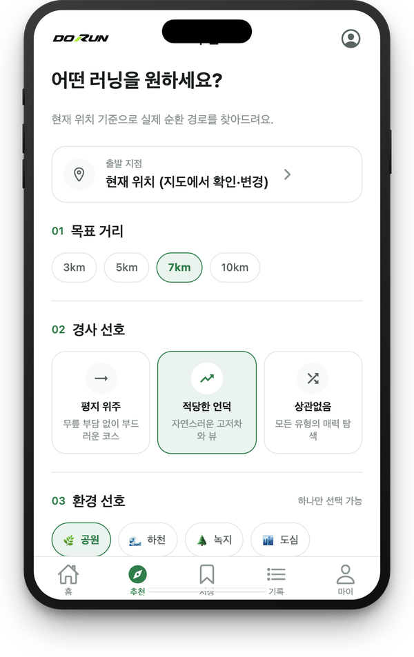
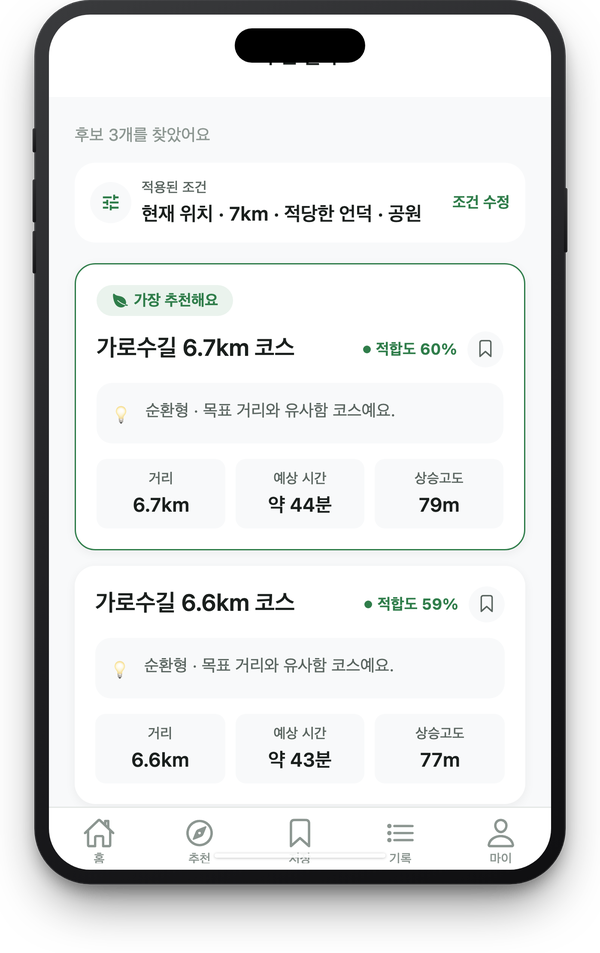
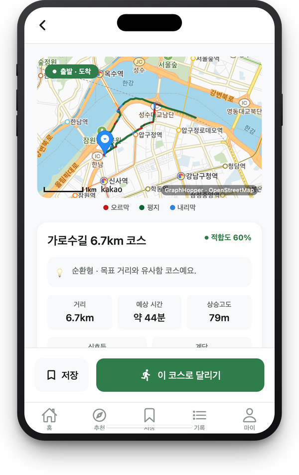

# DO RUN 🏃

조건에 맞는 **실제로 뛸 수 있는 러닝 코스**를 찾아주는 앱입니다.
거리·경사·환경을 고르면 순환·왕복 코스 후보를 만들고, 코스 상세 → 러닝 → 기록·평가까지 한 앱에서 이어집니다.

**라이브 데모**: https://dist-zeta-drab-3952qfifii.vercel.app (웹, 모바일 화면 기준)

| 1. 조건 설정 | 2. 추천 결과 | 3. 코스 상세 |
|:---:|:---:|:---:|
|  |  |  |

## 주요 기능
- **조건 설정**: 목표 거리(3·5·7·10km), 경사(평지/적당한 언덕/상관없음), 환경(공원·하천·녹지·도심), 추가 조건(신호등 적음·계단 없음)
- **코스 추천**: 순환형·왕복형 후보를 만들고 적합도 순으로 비교
- **코스 상세**: 지도 위에 오르막·평지·내리막을 색으로 구분해서 표시, 신호등·계단 수 확인
- **러닝**: GPS로 실시간 위치·거리·페이스 기록, 코스 저장
- **기록·평가**: 코스별 완주 횟수와 기록, 완주 후 만족도·조건 일치도·좋았던 점 남기기
- **계정**: 카카오·구글·이메일 로그인, 최초 1회 약관 동의, 회원 탈퇴
- 로그인 없이도 조건을 먼저 입력해볼 수 있고, 로그인하면 입력한 조건 그대로 추천이 이어집니다.

## 코스는 이렇게 만들어져요
```
조건 입력 → 출발지 주변 "좋은 길"(공원·강변·자전거길) 탐색(Overpass)
         → 경유지 라우팅으로 후보 생성(GraphHopper) → 같은 길 되돌아오는 가지 제거·모양 점수
         → 각 후보의 환경 비율·신호등·계단 조회(Overpass) → 적합도 계산 → 상위 3개 반환
```
적합도(0~100)는 **규칙 기반 가중합**입니다. 거리 40 · 경사 25 · 환경 25 · 추가 조건 10.
보행 금지·출입 통제 구간을 지나는 후보는 제외합니다. (머신러닝/LLM은 사용하지 않습니다.)

## 기술 스택
| 영역 | 사용 |
|---|---|
| 앱 | Expo SDK 57, React Native 0.86, expo-router (iOS·Android·웹) |
| 상태 | Zustand |
| 백엔드 | Supabase (Auth, Postgres, Edge Functions, Storage) |
| 경로·지도 데이터 | GraphHopper Directions API, OpenStreetMap(Overpass API) |
| 지도 표시 | 카카오맵 JS SDK (WebView, [running-course-map-web](https://github.com/juribb/running-course-map-web)) |
| 배포 | Vercel (웹 정적 배포) |

## 시작하기
```bash
npm install
cp .env.example .env     # 아래 값을 채우기
npx expo start --web     # 웹으로 실행 (http://localhost:8081)
```
`.env`에 필요한 값: `EXPO_PUBLIC_SUPABASE_URL`, `EXPO_PUBLIC_SUPABASE_ANON_KEY`,
`EXPO_PUBLIC_KAKAO_NATIVE_APP_KEY`, `EXPO_PUBLIC_KAKAO_JS_KEY`

**서버 쪽 준비** (본인 Supabase 프로젝트 기준)
```bash
npx supabase link --project-ref <프로젝트 ref>
npx supabase db push                          # supabase/migrations 적용
npx supabase secrets set GRAPHHOPPER_API_KEY=<키> GRAPHHOPPER_API_KEY_2=<선택>
npx supabase functions deploy recommend
npx supabase functions deploy delete-account
```
카카오·구글 로그인은 Supabase Auth의 Provider 설정과 Redirect URL 허용 목록에 앱 주소를 등록해야 동작합니다.

## 웹 배포
```bash
bash scripts/deploy-web.sh
```
빌드, 아이콘 폰트 경로 보정(Vercel이 `node_modules` 폴더를 제외하는 문제 회피), Vercel 설정 복원, 배포를 한 번에 처리합니다.

## 폴더 구조
```
app/(tabs)/            화면 (모든 화면이 하나의 탭 네비게이터 안)
src/lib, stores        서버 호출·도메인 로직, 전역 상태
src/constants          옵션·적합도 가중치·약관 문구
supabase/functions/    recommend(코스 추천), delete-account(회원 탈퇴)
supabase/migrations/   DB 스키마 (0001~0014)
scripts/               배포 스크립트
docs/images/           README 스크린샷
```
개발 시 주의할 점은 [CLAUDE.md](CLAUDE.md)에 정리돼 있습니다.

## 알려진 한계
- 경로 품질은 OpenStreetMap 태깅과 GraphHopper의 보행 라우팅에 의존하며, 실제 보도 유무는 보장하지 않습니다.
- 완주 후 평가는 저장·조회만 되고, 추천 결과에는 아직 반영되지 않습니다.
- 고도는 약 30m 해상도의 DEM 기반이라 짧은 계단·육교 같은 미세한 고저차는 반영되지 않습니다.
- 무료 플랜 서버(Supabase)는 오래 사용하지 않으면 일시정지되어 추천·로그인이 동작하지 않을 수 있습니다.

## 데이터 출처
지도·시설 데이터 © [OpenStreetMap contributors](https://www.openstreetmap.org/copyright) (ODbL),
경로 계산 [GraphHopper](https://www.graphhopper.com/), 지도 표시 카카오맵.
